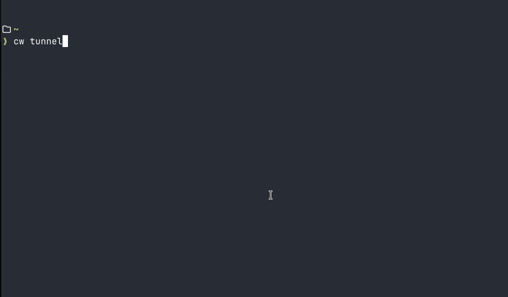
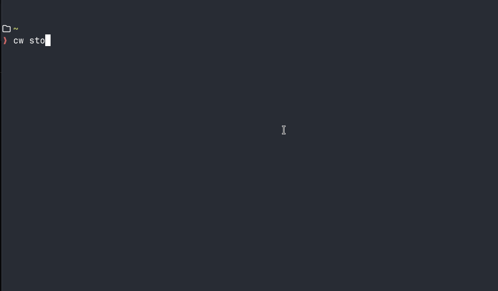
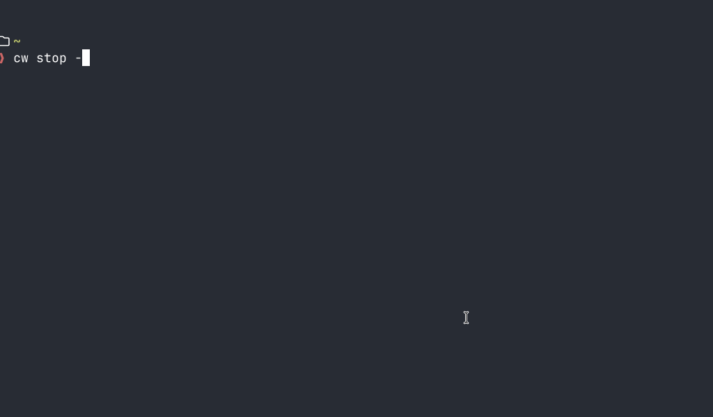

# Cloud Workstation Tool

Helper tool to start, stop and start a tunnel to connect to [Google Cloud Workstation](https://docs.cloud.google.com/workstations/docs/overview).

## Installation

Download from the [Releases](https://github.com/xaviatwork/cloud-workstation-tool/releases) page.

Cloud Workstation Tool is a single binary; no need to install ¯\\\_(ツ)_/¯

### Create the configuration folder

* MacOS/Linux: `mkdir -p ~/.config/cloud-workstation`
* Windows: `mkdir %USERPROFILE%\cloud-workstation`

### Create the configuration file

Create a JSON configuration file (default is `cw.cfg`) in the Cloud Workstation Tool configuration folder with the following structure:

```json
{
    "name": "WORKSTATION_NAME",
    "project_id": "GOOGLE_CLOUD_PROJECT_ID",
    "region": "REGION",
    "cluster": "CLOUD_WORKSTATION_CLUSTER_NAME",
    "cluster_config": "CLUSTER_CONFIG",
    "local": "LOCAL_PORT"
}
```

* WORKSTATION_NAME: Name of the Cloud Workstation. Example: `my-workstation`
* GOOGLE_CLOUD_PROJECT_ID: Google Cloud Project ID where the Workstation is located.
* REGION: Google Cloud region where the Workstation is located.
* CLOUD_WORKSTATION_CLUSTER_NAME: Name of the cluster managing the Cloud Workstation
* CLUSTER_CONFIG: Name of the Cloud Workstation configuration used by the Cloud Workstation
* LOCAL: Local port to connect to the SSH tunnel

Use the `-c` or `--conf` flags to specify the location of a configuration file other than the default.

## Run

### `cw tunnel`

Starts the Cloud Workstation and creates a tunnel to enable SSH connections to the Cloud Workstation.

As there's no API endpoint to create the tunnel, the `cw` tool runs the corresponding `gcloud`(*) command.

> See [gcloud workstations start-tcp-tunnel](https://docs.cloud.google.com/sdk/gcloud/reference/workstations/start-tcp-tunnel)
>
> ```shell
> # Example from Google's documentation:
> gcloud workstations start-tcp-tunnel --project=my-project --region=us-central1 --cluster=my-cluster --config=my-config my-workstation 22
> ```

* = Requires `gcloud` installed.

The tunnel remains open until `cw` is terminated (using `Ctrl+C`).

`cw` blocks the terminal even if the if the Cloud Workstation is stopped and the tunnel is closed (e.g., using Google Cloud's web console).



#### Options

If `-only` is provided, then `cw` only creates the tunnel, but it doesn't start the Cloud Workstation. This may reslt in the tunnel not being created, if the Cloud Workstation is not running.

### `cw start`

Start the Cloud Workstation machine if it's stopped.

`cw start` blocks the terminal until the Cloud Workstation has fully started.

### `cw stop`

Stop the Cloud Workstation machine if it's running (started).

`cw stop` blocks the terminal until the Cloud Workstation has fully stopped.



### `--quiet`

By default, `cw` displays information about the Cloud Workstation like the Google Project ID, region, cluster and config name  and so on...

* Example **whithout** `--quiet` (default):



Using `--quiet`, `cw` does not display this information.

## Help

Use `-h` or `--help` to get usage information about the application or any of the available commands:

```console
$ cw -h
cw is a wrapper around gcloud to start/stop Cloud Workstations and to create a tunnel to them.
v2.x relies on gcloud completely, to avoid having to set ADC for starting/stopping the Cloud Workstation.

Usage:
  cw [command]

Available Commands:
  completion  Generate the autocompletion script for the specified shell
  help        Help about any command
  start       starts the Cloud Workstation if it's stopped
  stop        stops the Cloud Workstation if it's running
  tunnel      starts the Cloud Workstation and creates a tunnel to it

Flags:
  -c, --conf string   Configuration file
  -h, --help          help for cw
  -q, --quiet         Don't display Cloud Workstation information
  -v, --version       version for cw

Use "cw [command] --help" for more information about a command.
```

For one of the commands:

```console
$ cw tunnel --help
starts the Cloud Workstation and creates a tunnel to it

Usage:
  cw tunnel [flags]

Flags:
  -h, --help   help for tunnel
      --only   Create only the tunnel (do not start the Cloud Workstation)

Global Flags:
  -c, --conf string   Configuration file
  -q, --quiet         Don't display Cloud Workstation information
```

## Eneable shell autocompletion

Generate the autocompletion file for your shell using and source it.

For additional information, run `cw completion --help`.

## Connect the IDE to the Cloud Workstation

To connect your local IDE to the Cloud Workstation, please check the official documentation:

* [Develop code using a local VS Code editor](https://docs.cloud.google.com/workstations/docs/develop-code-using-local-vscode-editor)
* [Develop code using local JetBrains IDEs](https://docs.cloud.google.com/workstations/docs/develop-code-using-local-jetbrains-ides)
