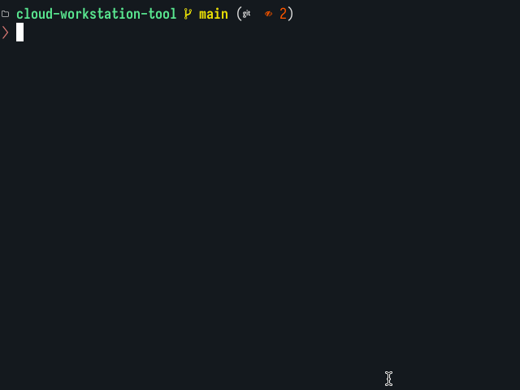
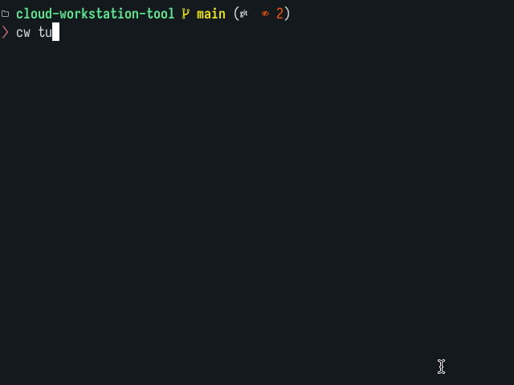
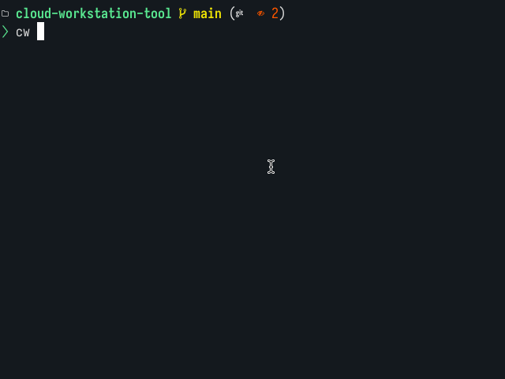
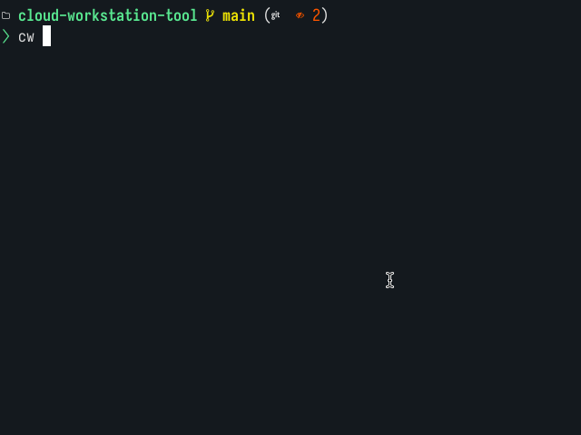
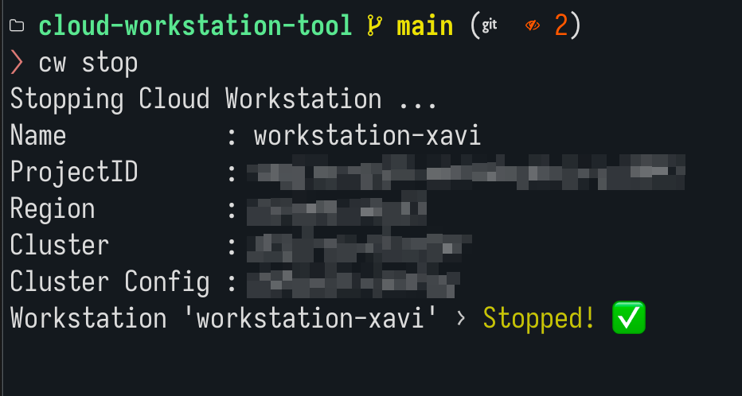

# Cloud Workstation Tool

Helper tool to start, stop and start a tunnel to connect to [Google Cloud Workstation](https://docs.cloud.google.com/workstations/docs/overview).

## Installation

Download from the [Releases](https://github.com/xaviatwork/cloud-workstation-tool/releases) page.

Cloud Workstation Tool is a single binary; no need to install ¯\\\_(ツ)_/¯

### Create the configuration folder

* MacOS/Linux: `mkdir -p ~/.config/cloud-workstation`
* Windows: `mkdir %USERPROFILE%\cloud-workstation`

### Create the configuration file

Create a JSON configuration file `cw.cfg` in the Cloud Workstation Tool configuration folder with the following structure:

```json
{
    "name": "WORKSTATION_NAME",
    "project_id": "GOOGLE_CLOUD_PROJECT_ID",
    "region": "REGION",
    "cluster": "CLOUD_WORKSTATION_CLUSTER_NAME",
    "cluster_config": "CLUSTER_CONFIG",
    "local": "LOCAL_PORT"
}
```

* WORKSTATION_NAME: Name of the Cloud Workstation. Example: `my-workstation`
* GOOGLE_CLOUD_PROJECT_ID: Google Cloud Project ID where the Workstation is located.
* REGION: Google Cloud region where the Workstation is located.
* CLOUD_WORKSTATION_CLUSTER_NAME: Name of the cluster managing the Cloud Workstation
* CLUSTER_CONFIG: Name of the Cloud Workstation configuration used by the Cloud Workstation
* LOCAL: Local port to connect to the SSH tunnel

## Run

### `cw tunnel`

Creates a tunnel to enable SSH connections to the Cloud Workstation.

As there's no API endpoint to create the tunnel, the `cw` tool runs the corresponding `gcloud`(*) command.

> See [gcloud workstations start-tcp-tunnel](https://docs.cloud.google.com/sdk/gcloud/reference/workstations/start-tcp-tunnel)
>
> ```shell
> # Example from Google's documentation:
> gcloud workstations start-tcp-tunnel --project=my-project --region=us-central1 --cluster=my-cluster --config=my-config my-workstation 22
> ```

* = Requires `gcloud` installed.

The tunnel remains open until `cw` is terminated (using `Ctrl+C`).

`cw` blocks the terminal even if the if the Cloud Workstation is stopped and the tunnel is closed (e.g., using Google Cloud's web console).

* Tunnel fails to start if Cloud Workstation is stopped:



#### Options

If `-up` is provided, then `cw` checks the state of the Cloud Workstation; if it's stopped, `cw` starts the Cloud Workstatation, waits until it has started and then, it creates the tunnel.

* Tunnel waits until the Cloud Workstation is started (using `-up`):



### `cw start`

Start the Cloud Workstation machine if it's stopped.

`cw start` blocks the terminal until the Cloud Workstation has fully started.



### `cw stop`

Stop the Cloud Workstation machine if it's running (started).

`cw stop` blocks the terminal until the Cloud Workstation has fully stopped.



### `--quiet`

By default, `cw` displays information about the Cloud Workstation like the Google Project ID, region, cluster and config name  and so on...

* Example **whithout** `--quiet` (default):



Using `--quiet`, `cw` does not display this information.

## Connect the IDE to the Cloud Workstation

To connect your local IDE to the Cloud Workstation, please check the official documentation:

* [Develop code using a local VS Code editor](https://docs.cloud.google.com/workstations/docs/develop-code-using-local-vscode-editor)
* [Develop code using local JetBrains IDEs](https://docs.cloud.google.com/workstations/docs/develop-code-using-local-jetbrains-ides)
